PR #69、#70、#71 最後線上驗收報告

核驗時間：2026/11/13 00:18（Asia/Taipei）。本報告取代前次僅涵蓋 PR #69、#70 的結論。

三個 PR 的修正在線上完整保留；**17 頁全部通過，本次驗收範圍內未發現未解決問題**。前次唯一未解的 P.74 星號排版問題已由 PR #71 解決；P.19 的 29.16 W 與全精度說明也仍保留。

驗收時 main 與線上發布 SHA 均為 `f660bf9abf55c002e8779147ed4a8b9f5f221574`。各組驗收前後均核對 release；五個相關線上 JavaScript 檔案與此 commit 的內容及 SHA-256 完全相同。PR #69 的 11 個修改檔案中，9 個逐位元組保留；另 2 個完整檔案的差異僅是 PR #70 的 P.19 損耗說明與 PR #71 刪除 P.74 四個星號。

| PR | 修正範圍 | 合併狀態與 commit |
|---|---|---|
| [#69](https://github.com/linwuyen/-EEHandouts/pull/69) | R2 九項導讀、方向、公式、算例與波形修正 | 已合併 · [bc35d6b8425c](https://github.com/linwuyen/-EEHandouts/commit/bc35d6b8425c6630178bb4fa6bbad98c71ad2102) |
| [#70](https://github.com/linwuyen/-EEHandouts/pull/70) | 中冊 P.19 損耗保留全精度後四捨五入 | 已合併 · [b510b258d5fd](https://github.com/linwuyen/-EEHandouts/commit/b510b258d5fd53539dbfbd80c28342967edf9c58) |
| [#71](https://github.com/linwuyen/-EEHandouts/pull/71) | 上冊 P.74 移除原樣顯示星號 | 已合併 · [f660bf9abf55](https://github.com/linwuyen/-EEHandouts/commit/f660bf9abf55c002e8779147ed4a8b9f5f221574) |

本輪使用 Chromium 141.0.7390.37 的新工作階段，實際由首頁→冊別→原講義索引→指定頁進入；P.83–85 與 P.93–96 再從導讀連結進入課節。正常公式與刻意阻擋 KaTeX 後的純文字備援均核對，頁面 JavaScript 錯誤為 0。每頁截圖如下，均為這個發布版本的新證據。

| 頁面 | 結果 | 實際驗收結果 | 本輪截圖 |
|---|---|---|---|
| [上冊 P.4](https://linwuyen.github.io/-EEHandouts/index.html#slide/4) | 通過 | 頁末以 +3 A／−3 A 各半週手算，平均 0 A、RMS 3 A。 | [截圖](screenshots/final697071-upper-p4-review.png) |
| [上冊 P.8](https://linwuyen.github.io/-EEHandouts/index.html#slide/8) | 通過 | DC 與不同頻率的均方相加：4+4.5+8=16.5，RMS≈4.062 A。 | [截圖](screenshots/final697071-upper-p8-review.png) |
| [上冊 P.11](https://linwuyen.github.io/-EEHandouts/index.html#slide/11) | 通過 | 手算 PF=400/500=0.8、CF=12/5=2.4；功率比與峰值比區分清楚。 | [截圖](screenshots/final697071-upper-p11-review.png) |
| [上冊 P.22](https://linwuyen.github.io/-EEHandouts/index.html#slide/22) | 通過 | i1 左上流入、i2 右上流出，淨安匝 N1i1−N2i2；實心同名端點標指向 P.24 圖 3-19。 | [截圖 1](screenshots/final697071-upper-p22-polarity.png)／[截圖 2](screenshots/final697071-upper-p22-worked.png) |
| [上冊 P.35](https://linwuyen.github.io/-EEHandouts/index.html#slide/35) | 通過 | IC1=0.20 A、IB2=0.21 A、末級 IC2=6.30 A、外部共接 C 端=6.50 A。 | [截圖](screenshots/final697071-upper-p35-worked.png) |
| [上冊 P.74](https://linwuyen.github.io/-EEHandouts/index.html#slide/74) | 通過 | 64.16° 起流、115.84° 達峰約 2.698 A、142.23° 歸零；下降穿越 Vd 後先降流；正規化曲線與 π/2 極限保留。 PR #71 移除指定前後四個星號；完整段落逐字保留。 | [截圖 1](screenshots/final697071-upper-p74-timing.png)／[截圖 2](screenshots/final697071-upper-p74-formatting.png) |
| [上冊 P.83](https://linwuyen.github.io/-EEHandouts/index.html#slide/83) | 通過 | 回電源為正，iN=iA+iB+iC；每相基波 5 Arms、同相三次 15%，25% 游標 −3.182 A，RMS 2.25 A；文字備援同號。 | [截圖 1](screenshots/final697071-upper-p83-neutral.png)／[截圖 2](screenshots/final697071-upper-p83-neutral-fallback.png) |
| [上冊 P.84](https://linwuyen.github.io/-EEHandouts/index.html#slide/84) | 通過 | 沿 P.83 回電源正向，iN=iA+iB+iC；不同頻率 RMS 平方合成，頁內例題約 6.185 A；連結波形 25% 仍為 −3.182 A。 | [截圖 1](screenshots/final697071-upper-p84-direction.png)／[截圖 2](screenshots/final697071-upper-p84-worked.png) |
| [上冊 P.85](https://linwuyen.github.io/-EEHandouts/index.html#slide/85) | 通過 | 同課節同步文字保留回電源正向與 iN=iA+iB+iC；實際點入課節，25% 游標 −3.182 A、RMS 2.25 A。 | [截圖 1](screenshots/final697071-upper-p85-direction.png)／[截圖 2](screenshots/final697071-upper-p85-neutral.png) |
| [上冊 P.93](https://linwuyen.github.io/-EEHandouts/index.html#slide/93) | 通過 | 由該頁導讀進入課節；PF=P3φ/(3×V相,rms×I線,rms)，三相總有功功率、相電壓及線電流定義齊全；KaTeX 與純文字備援皆正確。 | [截圖 1](screenshots/final697071-upper-p93-pf.png)／[截圖 2](screenshots/final697071-upper-p93-pf-fallback.png) |
| [上冊 P.94](https://linwuyen.github.io/-EEHandouts/index.html#slide/94) | 通過 | 由該頁導讀進入課節；PF=P3φ/(3×V相,rms×I線,rms)，三相總有功功率、相電壓及線電流定義齊全；KaTeX 與純文字備援皆正確。 | [截圖 1](screenshots/final697071-upper-p94-pf.png)／[截圖 2](screenshots/final697071-upper-p94-pf-fallback.png) |
| [上冊 P.95](https://linwuyen.github.io/-EEHandouts/index.html#slide/95) | 通過 | 由該頁導讀進入課節；PF=P3φ/(3×V相,rms×I線,rms)，三相總有功功率、相電壓及線電流定義齊全；KaTeX 與純文字備援皆正確。 | [截圖 1](screenshots/final697071-upper-p95-pf.png)／[截圖 2](screenshots/final697071-upper-p95-pf-fallback.png) |
| [上冊 P.96](https://linwuyen.github.io/-EEHandouts/index.html#slide/96) | 通過 | 由該頁導讀進入課節；PF=P3φ/(3×V相,rms×I線,rms)，三相總有功功率、相電壓及線電流定義齊全；KaTeX 與純文字備援皆正確。 | [截圖 1](screenshots/final697071-upper-p96-pf.png)／[截圖 2](screenshots/final697071-upper-p96-pf-fallback.png) |
| [中冊 P.15](https://linwuyen.github.io/-EEHandouts/middle.html#slide/15) | 通過 | 操作指示使用本頁 ON／OFF 導通損公式；RON 在 ON、VD 在 OFF；算例 Vo≈90.33 V。 | [截圖 1](screenshots/final697071-middle-p15-instructions.png)／[截圖 2](screenshots/final697071-middle-p15-example.png) |
| [中冊 P.19](https://linwuyen.github.io/-EEHandouts/middle.html#slide/19) | 通過 | 僅改 RON 0.1→0.2 Ω，Vo 90.33→89.48 V；總導通損 29.155678987… W 最後四捨五入為 29.16 W；中間保留全精度說明可見。 | [截圖](screenshots/final697071-p19-loss-rounding.png) |
| [中冊 P.21](https://linwuyen.github.io/-EEHandouts/middle.html#slide/21) | 通過 | 固定 Vo=100 V、L=100 µH、fs=100 kHz；D 0.35→0.50，Io,crit 0.739→0.625 A；IL,crit 在 D=1/2 最大，Io,crit 在 D=1/3 最大。 既有固定 Vin 互動模型保留。 | [截圖 1](screenshots/final697071-middle-p21-comparison.png)／[截圖 2](screenshots/final697071-middle-p21-fixed-vin-lesson.png) |
| [中冊 P.27](https://linwuyen.github.io/-EEHandouts/middle.html#slide/27) | 通過 | 紅谷底 Q1/Q2：Vin／0、+Vin；綠波峰 Q1p/Q2p：0／Vo、−Vo；兩段間 Q1/Q2p：Vin／Vo、Vin−Vo。斜率為 vL/L，第三段隨差值正／負／零上升／下降／水平。 | [截圖](screenshots/final697071-middle-p27-gate-states.png) |

三相 PF 接受值獨立核算：584.50/(3×120×2.749)=0.590618811≈0.591；P 為三相總有功功率、V 為相電壓 RMS、I 為線電流 RMS。

已解決問題：

- 中冊 P.19（PR #70）：總損耗統一為 29.16 W，中間 Vo、Io、IL 與功率保留全精度，最後才四捨五入。
- 上冊 P.74（PR #71）：原樣顯示的 Markdown 星號已移除，「正規化平均電流對電壓曲線」與其完整段落均保留。

**未解決問題：0 項（本次 17 頁與對應課節的驗收範圍）。**

既有 CI 與發布狀態：

- [PR #71 Verify](https://github.com/linwuyen/-EEHandouts/actions/runs/43250185695)：SUCCESS，commit `ebcd222e595f`。
- [PR #71 分支 Verify](https://github.com/linwuyen/-EEHandouts/actions/runs/43250121687)：SUCCESS，commit `ebcd222e595f`。
- [main Verify：完整 Node 22／Chromium npm test](https://github.com/linwuyen/-EEHandouts/actions/runs/43252947661)：SUCCESS，commit `f660bf9abf55`。
- [既有正式發布](https://github.com/linwuyen/-EEHandouts/actions/runs/43255605508)：SUCCESS，commit `f660bf9abf55`。

本次為只讀線上複驗，未修改產品或重跑完整 npm test；完整測試採同一發布 commit 已成功的既有 CI，已重新查核成功狀態。CI 依現有 verify.yml 使用 Node 22、準備 PDF.js、啟動本機網站後執行 npm test，Chromium 測試成功。

驗收範圍：本輪驗收線上逐頁導讀、對應課節、公式、純文字備援與互動波形；依使用者提供的原圖方向規格核對，未重新載入原始 PDF。

詳細證據：

- [final697071-upper-4-8-11-verification.json](evidence/final697071-upper-4-8-11-verification.json)
- [final697071-upper-22-35-verification.json](evidence/final697071-upper-22-35-verification.json)
- [final697071-p74-verification.json](evidence/final697071-p74-verification.json)
- [final697071-middle-p15-verification.json](evidence/final697071-middle-p15-verification.json)
- [final697071-p19-loss-rounding-verification.json](evidence/final697071-p19-loss-rounding-verification.json)
- [final697071-middle-p21-verification.json](evidence/final697071-middle-p21-verification.json)
- [final697071-middle-p21-fixed-vin-confirmed.json](evidence/final697071-middle-p21-fixed-vin-confirmed.json)
- [final697071-middle-p27-verification.json](evidence/final697071-middle-p27-verification.json)
- [final697071-neutral-pf-verification.json](evidence/final697071-neutral-pf-verification.json)
- [final697071-source-integrity-verification.json](evidence/final697071-source-integrity-verification.json)

截圖總覽（可展開直接查看）：

上冊 P.4：通過

頁末以 +3 A／−3 A 各半週手算，平均 0 A、RMS 3 A。

上冊 P.8：通過

DC 與不同頻率的均方相加：4+4.5+8=16.5，RMS≈4.062 A。

上冊 P.11：通過

手算 PF=400/500=0.8、CF=12/5=2.4；功率比與峰值比區分清楚。

上冊 P.22：通過

i1 左上流入、i2 右上流出，淨安匝 N1i1−N2i2；實心同名端點標指向 P.24 圖 3-19。

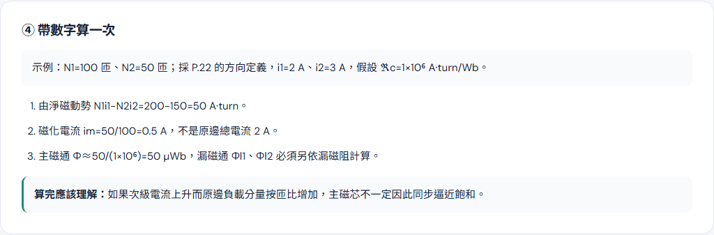

上冊 P.35：通過

IC1=0.20 A、IB2=0.21 A、末級 IC2=6.30 A、外部共接 C 端=6.50 A。

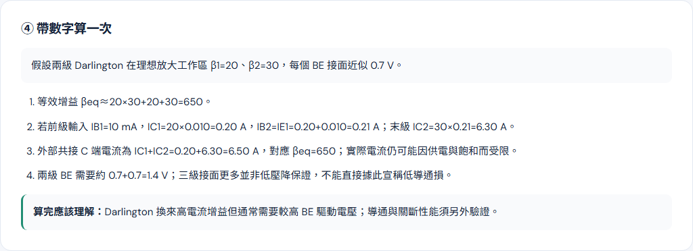

上冊 P.74：通過

64.16° 起流、115.84° 達峰約 2.698 A、142.23° 歸零；下降穿越 Vd 後先降流；正規化曲線與 π/2 極限保留。 PR #71 移除指定前後四個星號；完整段落逐字保留。

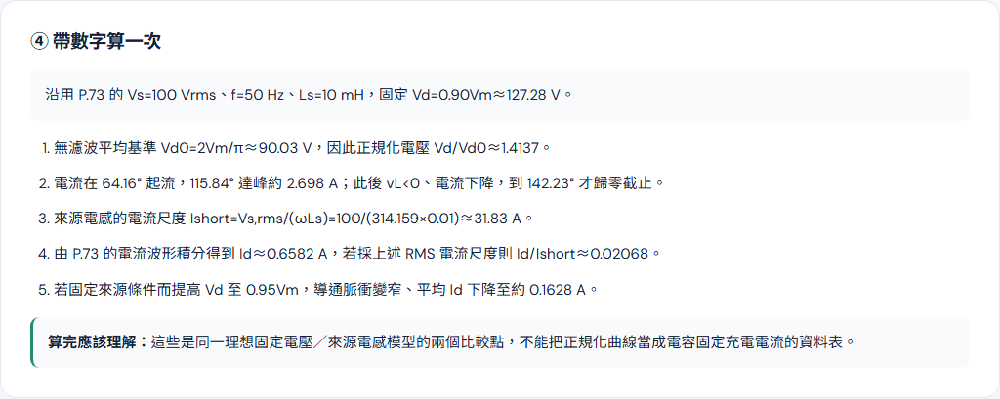

上冊 P.83：通過

回電源為正，iN=iA+iB+iC；每相基波 5 Arms、同相三次 15%，25% 游標 −3.182 A，RMS 2.25 A；文字備援同號。

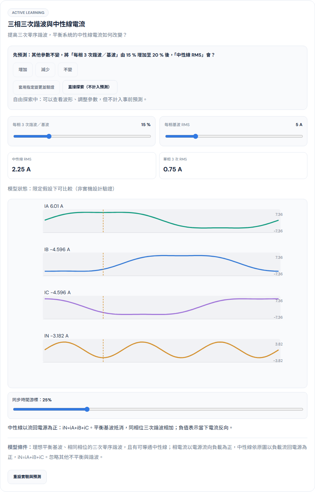

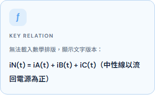

上冊 P.84：通過

沿 P.83 回電源正向，iN=iA+iB+iC；不同頻率 RMS 平方合成，頁內例題約 6.185 A；連結波形 25% 仍為 −3.182 A。

上冊 P.85：通過

同課節同步文字保留回電源正向與 iN=iA+iB+iC；實際點入課節，25% 游標 −3.182 A、RMS 2.25 A。

上冊 P.93：通過

由該頁導讀進入課節；PF=P3φ/(3×V相,rms×I線,rms)，三相總有功功率、相電壓及線電流定義齊全；KaTeX 與純文字備援皆正確。

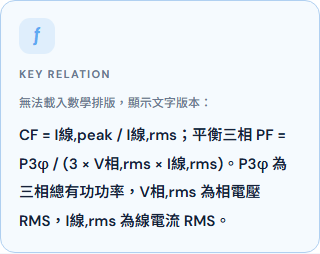

上冊 P.94：通過

由該頁導讀進入課節；PF=P3φ/(3×V相,rms×I線,rms)，三相總有功功率、相電壓及線電流定義齊全；KaTeX 與純文字備援皆正確。

上冊 P.95：通過

由該頁導讀進入課節；PF=P3φ/(3×V相,rms×I線,rms)，三相總有功功率、相電壓及線電流定義齊全；KaTeX 與純文字備援皆正確。

上冊 P.96：通過

由該頁導讀進入課節；PF=P3φ/(3×V相,rms×I線,rms)，三相總有功功率、相電壓及線電流定義齊全；KaTeX 與純文字備援皆正確。

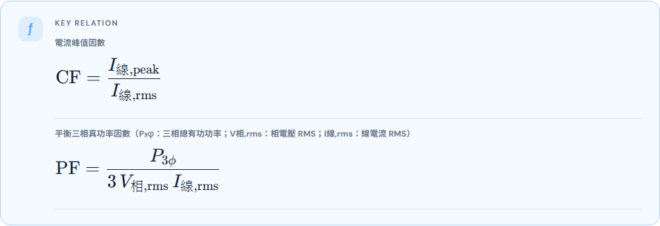

中冊 P.15：通過

操作指示使用本頁 ON／OFF 導通損公式；RON 在 ON、VD 在 OFF；算例 Vo≈90.33 V。

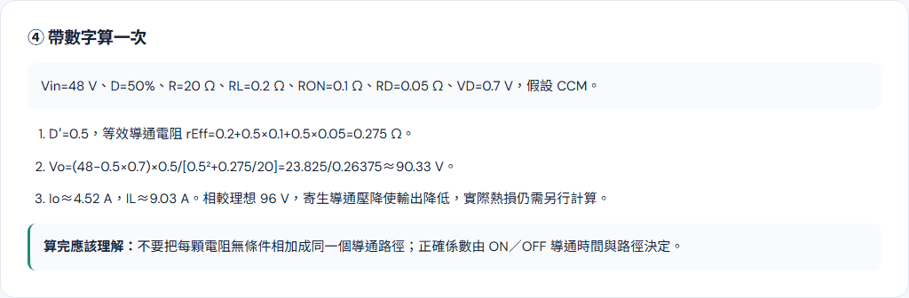

中冊 P.19：通過

僅改 RON 0.1→0.2 Ω，Vo 90.33→89.48 V；總導通損 29.155678987… W 最後四捨五入為 29.16 W；中間保留全精度說明可見。

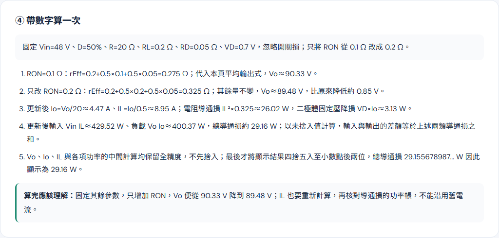

中冊 P.21：通過

固定 Vo=100 V、L=100 µH、fs=100 kHz；D 0.35→0.50，Io,crit 0.739→0.625 A；IL,crit 在 D=1/2 最大，Io,crit 在 D=1/3 最大。 既有固定 Vin 互動模型保留。

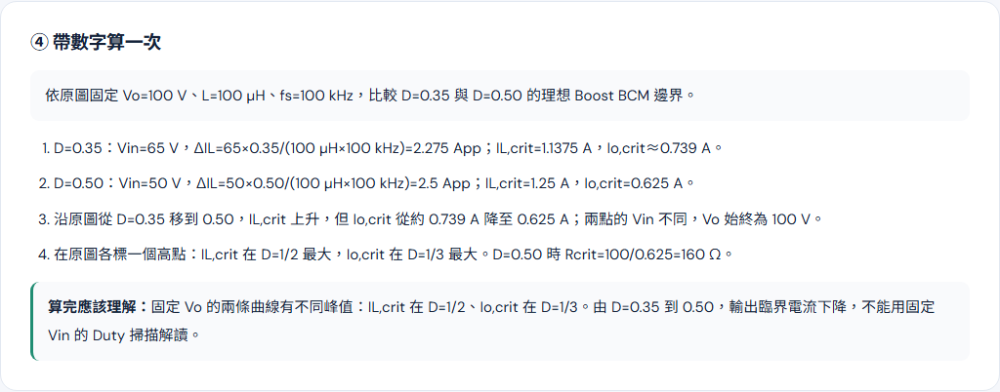

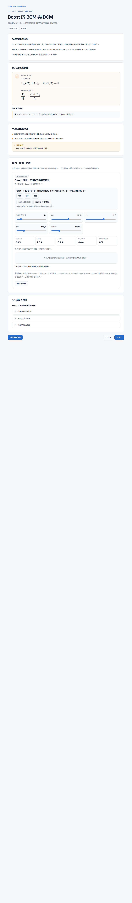

中冊 P.27：通過

紅谷底 Q1/Q2：Vin／0、+Vin；綠波峰 Q1p/Q2p：0／Vo、−Vo；兩段間 Q1/Q2p：Vin／Vo、Vin−Vo。斜率為 vL/L，第三段隨差值正／負／零上升／下降／水平。

